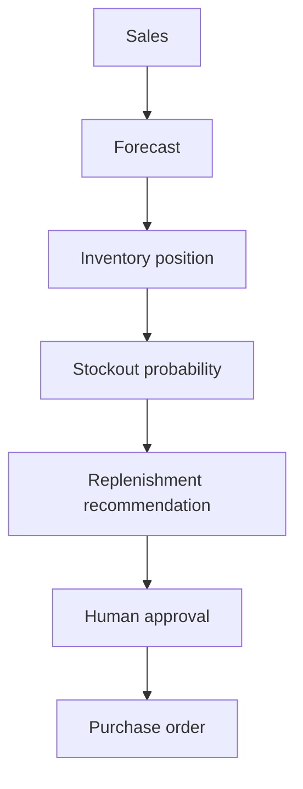
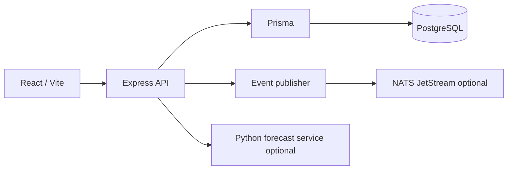

# Invorra

AI-assisted inventory intelligence and replenishment platform for FMCG brands selling through quick commerce.

Operators see which SKUs will stock out, why, and how many units to order. The order quantity is calculated in code. The assistant only reads those figures and explains them.

## Problem

Quick-commerce brands replenish city warehouses every few days. A planner staring at spreadsheets finds the stockout after the dark store already lost the sale. The hard part is not storing inventory. It is connecting recent sales, lead time, demand variability, and supplier case packs into one decision a person can approve.

## Solution

Invorra keeps that decision deterministic:



An assistant can answer "what should I order today?" by calling the same APIs. It cannot approve those orders until a person confirms.

## Features

- Multi-tenant organizations with owner, admin, operator, and viewer roles
- Products, warehouses, suppliers, inventory, and sales
- Weighted 7/14/30-day forecast with day-of-week seasonality
- Optional Python gradient-boosting forecast service (`gbm-demand-v2`) behind the same provider interface
- Stockout probability from lead time and demand variability
- Replenishment sized as forecast + safety stock − on-hand stock, rounded to MOQ
- Purchase orders with approval and a status timeline from the audit log
- Operations assistant grounded in live tenant data
- Audit log with actor, entity, metadata, and client IP
- Command-center dashboard with a 1/7/30/90 day range

## Architecture



Local development runs the API and web on the host. `docker compose up -d` starts PostgreSQL and NATS. The full stack is `docker compose --profile full up --build`.

## Tech stack

- React, TypeScript, Vite, Tailwind, Recharts
- Node.js, Express, Zod, Prisma
- PostgreSQL
- Optional: FastAPI, NumPy, scikit-learn, NATS JetStream

## Database design

Tenant-owned tables carry `organizationId`. Product SKU, warehouse code, and supplier code are unique per organization. Inventory is unique per product and warehouse. Monetary values are decimals. Sales, forecasts, recommendations, purchase orders, and audit logs are indexed by organization and the fields used in list filters.

`available stock = quantity − reserved quantity`. Sales decrement on-hand stock inside a transaction and refuse to go negative unless an owner or admin sets `allowNegative`.

## Replenishment algorithm

```text
safetyStock = ceil(1.65 × dailyStdDev × sqrt(leadTimeDays))
required = horizonForecast + safetyStock
raw = max(0, ceil(required − currentStock))
recommended = ceil(raw / MOQ) × MOQ
```

`1.65` is about a 95% cycle service level. The stored explanation quotes these integers. Example: forecast 1,820, safety stock 200, stock 340, MOQ 144 → raw 1,680 → recommended 1,728.

Stockout probability treats lead-time demand as normal. Mean is the sum of daily forecasts over the lead time. Sigma is the daily standard deviation times the square root of lead time. If days of cover are at or below lead time, risk is at least high.

## Forecasting

Default provider, `baseline`, runs in the API:

```text
baseline = 0.5 × 7-day average + 0.3 × 14-day average + 0.2 × 30-day average
predicted = baseline × weekdayIndex
```

Missing days count as zero. Confidence is half coverage (days with sales in the last 14) and half stability (`1 / (1 + coefficient of variation)`). It is not random.

`FORECAST_PROVIDER=python` calls `POST /forecast/batch` on the FastAPI service. The production model is `gbm-demand-v2`: an equal-style ensemble of two histogram gradient boosters (level demand and log demand), with lags, rolling means, weekday and month cycles, and a zero-after-demand flag. Histories shorter than 21 supervised days use a seasonal naive repeat of last week. Later horizon days are damped toward the recent weekly level. If the call fails, the API keeps the weighted moving average. The model does not see price or promotions, and it flags stockout-like zero days without imputing lost sales.

## AI assistant

`POST /api/assistant/chat` routes the question to tenant-scoped tools: inventory risks, recommendations, purchase orders, dashboard summary, and product lookup. The reply is a template over that JSON. If `AI_API_KEY` is set, a model may rewrite the wording, and the API discards the rewrite when it contains numbers that were not in the tool payload.

"Approve all of them" returns a confirmation id. Nothing is approved until `POST /api/assistant/confirm`.

## Security

- Helmet, CORS with credentials, 1 MB JSON limit
- JWT in an HTTP-only cookie, 7-day expiry, HS256
- bcrypt passwords; hashes are never returned
- Zod validation and pagination caps
- RBAC on every module
- `organizationId` comes from the session, not the body or query
- Updates use `updateMany` scoped by organization id
- Rate limit outside tests
- Stack traces only in development
- Prisma parameterizes queries, including raw SQL

## Multi-tenancy

Registration creates an organization and an owner. Every list and mutation filters by `req.user.organizationId`. A foreign id returns 404.

## Event architecture

Services publish after the database transaction commits:

`SALE_RECORDED`, `INVENTORY_UPDATED`, `FORECAST_GENERATED`, `RECOMMENDATION_CREATED`, `PO_CREATED`, `PO_APPROVED`, `PO_RECEIVED`.

With `NATS_URL` unset, events are structured logs. With it set, the publisher sends them to a JetStream stream named `INVORRA` and falls back to logs if NATS is down. Business code depends on `publishEvent`, not on the NATS client.

## Local development

```bash
cp .env.example .env
docker compose up -d
npm install
npx prisma generate
npx prisma migrate dev
npm run seed
npm run dev
npm run dev:web
```

API: `http://localhost:4000`  
Web: `http://localhost:5173`  
OpenAPI: `http://localhost:4000/api/openapi.yaml`

Demo login: `owner@nimbus.invorra` / `Password123!`  
Also seeded: `admin@`, `operator@`, and `viewer@` with the same password.

The web app proxies `/api` through Vite so the cookie stays on one origin. The token is not stored in localStorage.

## Docker

```bash
docker compose up -d
docker compose --profile full up --build
```

The default compose file starts PostgreSQL and NATS. The `full` profile also builds the API, web, and forecast service. Set `JWT_SECRET` before using that profile. Do not commit real secrets.

## Testing

```bash
npm test
npm run lint
npm run build
```

API tests cover auth, tenant isolation, sales transactions, stockout math, MOQ rounding, recommendation approval, and the assistant confirmation gate. Web tests cover error copy, the recommendation explanation panel, and protected routes.

## API documentation

`apps/api/openapi.yaml` is served at `GET /api/openapi.yaml`.

## Screenshots

Capture these after `npm run seed` and signing in as the owner:

1. Command center with the 30-day range
2. Inventory table sorted by risk
3. Replenishment detail showing forecast + safety stock − stock and the MOQ step
4. Purchase order timeline
5. Assistant answer for "What should I order today?"

## Future improvements

- Promotion and price features in the forecast
- Censored-demand adjustment when a SKU was already stocked out
- Durable assistant confirmations for more than one API instance
- Batch and expiry tracking for short-shelf-life SKUs
- Per-user notification when a recommendation expires

## Environment variables

| Name | Required | Purpose |
| --- | --- | --- |
| `DATABASE_URL` | yes | PostgreSQL |
| `JWT_SECRET` | yes | At least 32 characters |
| `PORT` | no | API port, default 4000 |
| `NODE_ENV` | no | development, test, or production |
| `CORS_ORIGIN` | yes | Browser origin allowed to send cookies |
| `AI_API_KEY` | no | Enables model wording. Empty uses templates |
| `AI_BASE_URL` | no | OpenAI-compatible base URL |
| `AI_MODEL` | no | Model name |
| `FORECAST_PROVIDER` | no | `baseline` or `python` |
| `ML_SERVICE_URL` | no | FastAPI forecast service |
| `NATS_URL` | no | JetStream server. Empty logs events |
